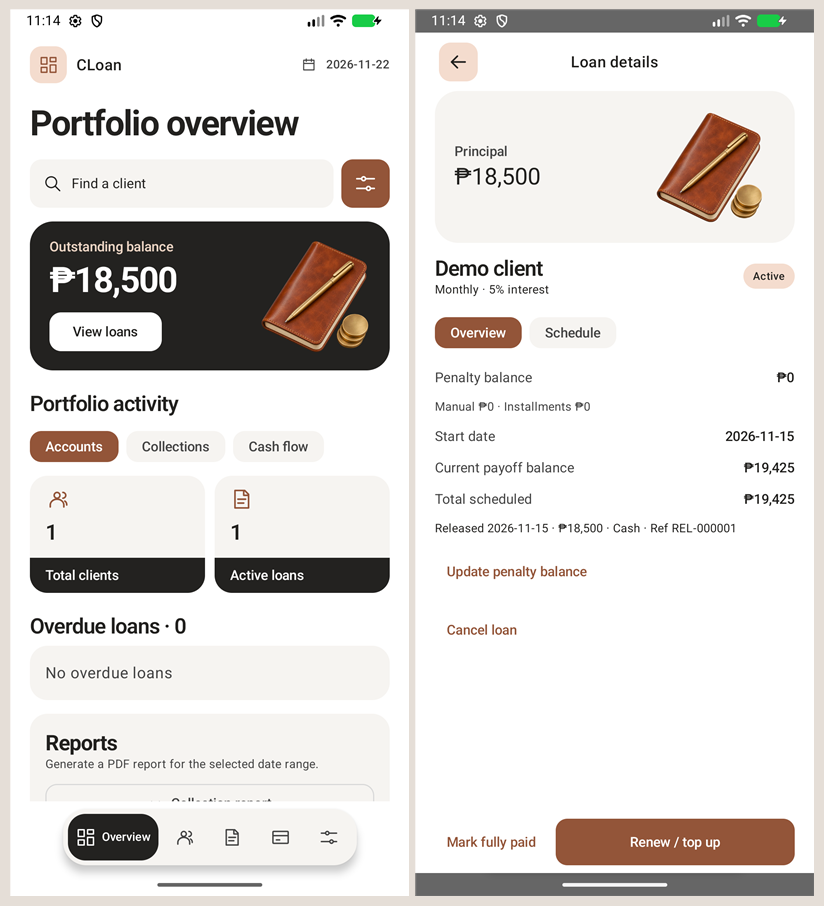

This is a Kotlin Multiplatform project targeting Android, iOS.

* [/iosApp](./iosApp/iosApp) contains an iOS application. Even if you’re sharing your UI with Compose Multiplatform,
  you need this entry point for your iOS app. This is also where you should add SwiftUI code for your project.

* [/shared](./shared/src) is for code that will be shared across your Compose Multiplatform applications.
  It contains several subfolders:
  - [commonMain](./shared/src/commonMain/kotlin) is for code that’s common for all targets.
  - Other folders are for Kotlin code that will be compiled for only the platform indicated in the folder name.
    For example, if you want to use Apple’s CoreCrypto for the iOS part of your Kotlin app,
    the [iosMain](./shared/src/iosMain/kotlin) folder would be the right place for such calls.
    Similarly, if you want to edit the Desktop (JVM) specific part, the [jvmMain](./shared/src/jvmMain/kotlin)
    folder is the appropriate location.

### Interface

Android uses Jetpack Compose Material 3 Expressive. The native SwiftUI interface on iOS follows the same terracotta, charcoal, and warm neutral palette. The overview shows the outstanding balance, with shortcuts to client search, loans, and settings. Use the Accounts, Collections, and Cash flow controls to switch between portfolio totals. Loan details group account information and the repayment schedule into separate views. Both apps follow the device’s light or dark appearance.

Ledger artwork

The built-in ImageGen tool generated the illustration packaged in the [Android drawable](shared/src/androidMain/res/drawable-nodpi/portfolio_ledger.png) and [iOS asset catalog](iosApp/iosApp/Assets.xcassets/PortfolioLedger.imageset/portfolio_ledger.png).

> Create a square transparent product photograph cutout of a closed cognac leather pocket ledger with cream page edges, a slim brass pen lying diagonally across its cover, and three stacked satin brass coins beside it. Three-quarter overhead studio view, softly directional light, carefully crafted tactile objects. A compact diagonal composition filling the frame, fully visible edges. Designed to read at small size on a charcoal loan app card. No text, logos, numerals, scenery or backdrop.

### Running the apps

Use the run configurations provided by the run widget in your IDE's toolbar. You can also use these commands and options:

- Android app: `./gradlew :androidApp:assembleDebug`
- iOS app: open the [/iosApp](./iosApp) directory in Xcode and run it from there.

### Running tests

Use the run button in your IDE's editor gutter, or run tests using Gradle tasks:

- Android tests: `./gradlew :shared:testAndroidHostTest`
- Android navigation tests on a connected device or emulator: `./gradlew :androidApp:connectedDebugAndroidTest`
- iOS tests: `./gradlew :shared:iosSimulatorArm64Test`

Running iOS simulator tests and building the SwiftUI app require macOS and Xcode.

### Local data

Clients, loans, payments, and the default penalty rule are stored in a local SQLite database through SQLDelight. The app starts with empty records; changes made in the menus persist across launches. Android and iOS each keep a separate database on the device.

---

Learn more about [Kotlin Multiplatform](https://www.jetbrains.com/help/kotlin-multiplatform-dev/get-started.html)…
